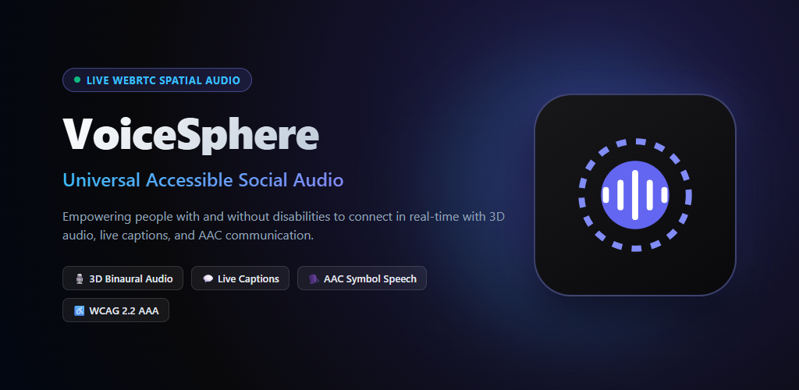

# VoiceSpheres (VoiceSphere) 🌐
### Global Accessible Voice Community – Free, Privacy-First, Worldwide-Testable MVP

<p align="center">
  
</p>

[](https://www.gnu.org/licenses/agpl-3.0)
[](ACCESSIBILITY.md)
[](https://nextjs.org/)
[](https://livekit.io/)
[](https://github.com/DilipGovind/voicespheres)
[](https://vercel.com)

> **"Every person deserves a voice, whether expressed through speech, text, technology, or assistive communication."**

**VoiceSpheres** (also known as **VoiceSphere**) is a modern, browser-based, open-source social audio platform inspired by Clubhouse and Twitter Spaces. Engineered from day one for universal accessibility and high-concurrency real-time audio, it brings together neurodivergent individuals, people with disabilities (PWD), and global audio communities.

🔗 **Repository**: [https://github.com/DilipGovind/voicespheres](https://github.com/DilipGovind/voicespheres)  
🏷️ **Keywords**: `voicespheres`, `voicesphere`, `social-audio`, `clubhouse-alternative`, `twitter-spaces-alternative`, `webrtc`, `livekit`, `accessibility`, `wcag-2.2-aaa`, `aac`, `nextjs`, `realtime-voice`

---

## 🚀 Key Deliverables & Documentation

| Document | Purpose |
|---|---|
| [`.env.example`](.env.example) | Clean placeholder values for LiveKit SFU, public app URL, and feature toggles |
| [`DEPLOYMENT_GUIDE.md`](DEPLOYMENT_GUIDE.md) | Local zero-cost dev mode, LiveKit Cloud free tier guide, Vercel frontend deploy, and self-hosted ports/firewall rules |
| [`COST_CHECKLIST.md`](COST_CHECKLIST.md) | Transparent cost breakdown separating $0 free tiers from potential paid scaling thresholds |
| [`TESTING_CHECKLIST.md`](TESTING_CHECKLIST.md) | Step-by-step checklist for two users on different networks (Wi-Fi vs Cellular) and across countries |
| [`PRODUCTION_READINESS.md`](PRODUCTION_READINESS.md) | Comprehensive audit checklist for security, reliability, privacy, accessibility, scaling, and real payments |
| [`ACCESSIBILITY.md`](ACCESSIBILITY.md) | Full specification of the 10 accessibility presets (A through J), WCAG 2.2 AAA guidelines, and assistive toolkits |

---

## 🌟 Core Technical Architecture

### 1. Pluggable Voice Provider Layer (`IVoiceAdapter`)
The voice engine is abstracted behind the `IVoiceAdapter` interface (`src/lib/voice/voice-adapter.interface.ts`):
- **`LiveKitVoiceAdapter` (`livekit-client`)**: Connects to LiveKit SFU servers using short-lived cryptographically signed tokens. Handles audio track publishing/subscribing, active speaker detection, connection state transitions, and audio element DOM management.
- **`MockVoiceAdapter`**: Fallback adapter for zero-credential local development, offline mode, and CI automated testing. Never crashes or requires paid cloud keys to boot.
- **Provider Switching**: Easily swap to Agora, Daily, or WebRTC Mesh without touching application UI logic.

### 2. Backend Security & Token API (`/api/voice/token`)
- **Node.js/TypeScript API**: Uses `livekit-server-sdk`'s `AccessToken` to mint short-lived JWT tokens (15-minute TTL).
- **Zero Client Secrets**: `LIVEKIT_API_SECRET` and admin keys remain strictly on the backend; never exposed to browser bundles.
- **Granular Permissions**:
  - Hosts & Speakers: Granted `canPublish: true, canSubscribe: true, canPublishData: true`.
  - Listeners: Granted `canPublish: false, canSubscribe: true, canPublishData: true`.
- **Server-Side Validation**:
  - Enforces private room passcodes.
  - Rejects joins if room is locked by host.
  - Enforces room capacity limits (e.g. max 12 testers for stable testing).

### 3. Clear Connection & Permission Status
A real-time status bar (`VoiceConnectionBanner.tsx`) informs users and assistive technology of network states:
- 🟢 **LiveKit WebRTC SFU Active**: Secure WSS Opus audio with latency estimation.
- 🔵 **Connecting**: Negotiating ICE and WebRTC transport.
- 🟡 **Reconnecting**: Automatic recovery when network fluctuates with manual "Force Reconnect" action.
- 🔴 **Microphone Access Blocked**: Prompts user with browser permission recovery instructions without breaking room participation.
- ⚪ **Local Demo Mode**: Clearly indicates when operating without LiveKit cloud keys.

### 4. Host Controls & Room Safety
- **Lock Room**: Prevents new external joiners from entering while a session is in progress.
- **Mute Participant**: Server-validated host action to mute unruly participants.
- **Role Progression**: Promote listeners to speakers or demote speakers to listeners.
- **Kick Participant & End Room**: Immediate room cleanup and participant disconnect.
- **Personal Mute & Client-Side Block**: Participants can block abusive users, instantaneously muting their audio and suppressing their captions and chat messages.

### 5. Demo 30-Day Trial & Coins Interface (Zero Real Payments)
- **100% Mock Testing**: Includes 30-day trial status tracker, demo coin balance (150 starting coins), daily bonus claims (+25 coins), and speaker tipping (10 coins).
- **Zero Real Money**: No credit card numbers, bank accounts, or UPI collected. Decoupled behind `IPaymentGateway` interface (`src/lib/payments/`).
- **Watermarked**: Every transaction and balance is watermarked as simulated demo data.

### 6. Optional AI Voice Companion (Disabled by Default)
- **Zero Cost Demo**: `Aria (AI Voice Companion)` runs locally using the browser's Web Speech API (`SpeechSynthesis`).
- **No Paid API**: Requires no OpenAI or ElevenLabs credentials and incurs $0 charges.
- **Disabled by default**: Host or participant can toggle it on from room controls.

---

## 🚀 Quick Start

### 1. Run Locally (Zero Credentials Needed)
```bash
# 1. Install dependencies
npm install

# 2. Run the automated test suite (35 tests passing)
npm test

# 3. Start local development server
npm run dev
```
Open [http://localhost:3000](http://localhost:3000) in your browser.

### 2. Run with LiveKit Cloud for Worldwide Remote Testing
1. Create a free account at [LiveKit Cloud](https://cloud.livekit.io) (50 GB/mo free).
2. Copy `.env.example` to `.env.local` and add your project keys:
   ```env
   LIVEKIT_URL=wss://your-project.livekit.cloud
   LIVEKIT_API_KEY=APIxxxxxxxxxx
   LIVEKIT_API_SECRET=secretxxxxxxxxxxxxxxxxxxxxxxxxxxxx
   ```
3. Run `npm run dev`. Your room voice sessions now route through multi-region WebRTC edge servers worldwide!

---

## 🧪 Automated Test Suite

VoiceSphere features 35 automated unit and integration tests with 100% pass rate:
```bash
npm test
```
- `tests/voice-adapter.test.ts`: Voice adapter lifecycle, muting, connection states, and factory.
- `tests/payment-trial.test.ts`: 30-day trial calculation, demo coins, daily rewards, and speaker tips.
- `tests/voice-token-api.test.ts`: Server token generation, role grant scoping, and private passcode verification.
- `tests/accessibility.test.ts`: All 10 presets and WCAG AAA settings.
- `tests/aac.test.ts`: Mandatory AAC phrases and symbol communication boards.
- `tests/i18n.test.ts`: 21 global languages and RTL switching.
- `tests/room-flow.test.ts`: Structured stage progression and participant lifecycle.
- `tests/cross-platform-sync.test.ts`: Multi-client state synchronization.
- `tests/share-and-creation.test.ts`: URL serialization and portable room sharing.

---

## 📄 License

Licensed under the **GNU Affero General Public License v3.0 (AGPL-3.0)**.
Free and accessible to all people.
